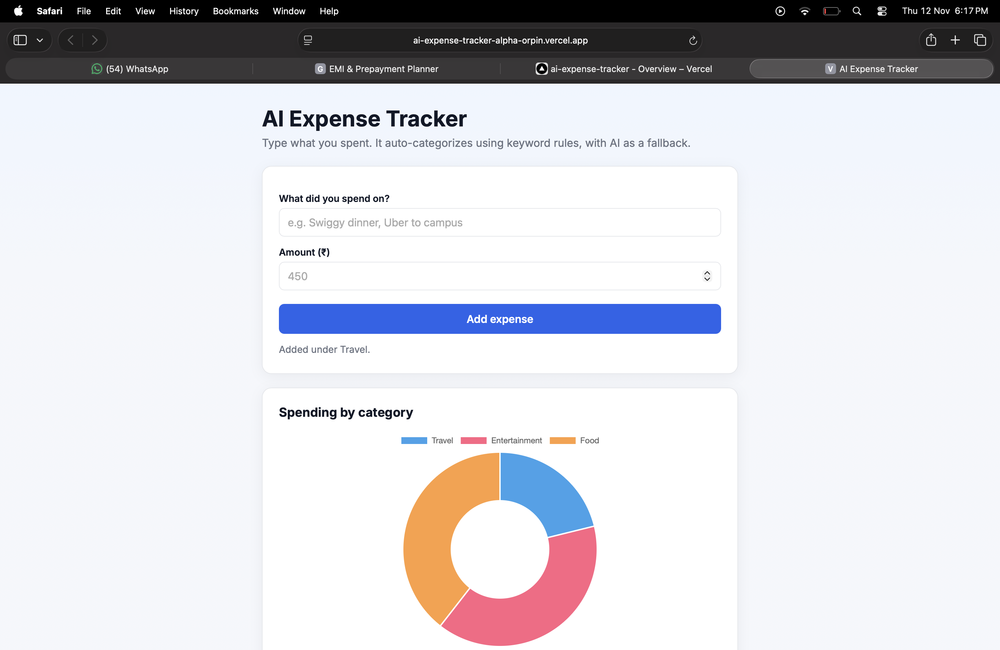

# AI Expense Tracker

A web app that tracks expenses and categorizes them automatically using keyword rules, with an AI model as a fallback.

**Live demo:** (your Vercel link)

## How it works
1. Keyword rules categorize common merchants instantly (Swiggy, Uber, etc.).
2. If no rule matches, the description is sent to a serverless function (`api/categorize.js`) that asks the Gemini API for a category.
3. The function only accepts answers from a fixed category list. Anything else becomes "Other".
4. If a model is overloaded (503) or unavailable, it retries with the next model in a list. If all fail, the expense is saved as "Other" and the app keeps working.

## Features
- Add and delete expenses, with totals and a category chart
- Hybrid categorization: rules first, AI second
- Data saved in the browser (localStorage)

## Tech stack
HTML, CSS, JavaScript, Chart.js, Vercel serverless function, Gemini API

## Problems I solved
- **Keeping the API key secret:** the key lives in server-side environment variables, never in the browser or the repo.
- **Unreliable AI responses:** output is validated against an allowed list, and the function falls back across models and to a safe default when the API returns 503 or 429.

## Known limitation
The AI step depends on a free-tier API, so during high demand it can be temporarily unavailable. In that case unknown expenses are categorized as "Other".

## What I'd add next
- Natural-language entry ("spent 450 on petrol yesterday")
- Bank statement CSV import
- Monthly spending summary
